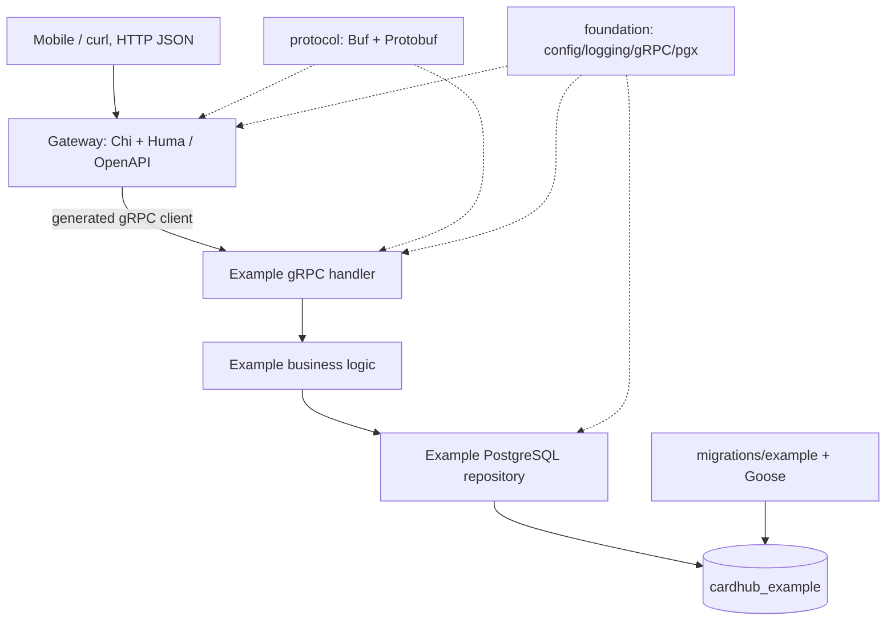

# Scaffold architecture

## Request path

## Responsibility boundaries

| Module | Owns | Must not own |
| --- | --- | --- |
| `gateway` | Public HTTP types/validation, OpenAPI, request logging, internal gRPC clients and HTTP status mapping | Business logic or SQL |
| `service-example` | Business rules, gRPC handler, its repository and tables | Public API/OpenAPI |
| `protocol` | Versioned protobuf interfaces and generated Go bindings | Application behavior |
| `foundation` | Process config, Zap logging, common gRPC interceptors/health/reflection, pgx pool connection | Domain types or service-specific SQL |
| `migrations` | Versioned SQL files and migration-runner configuration | Runtime business code |

`gateway`, `service-example`, `foundation`, and `protocol` are separate Go modules. Relative `replace` directives in the two runnable modules refer to sibling modules, matching TimBRA. **No root `go.mod` and no `go.work`**. Docker builds use the repository as their context so sibling modules are present.

## Database ownership versus migration location

Migration SQL lives centrally at `migrations/<service>/`, but **each service owns only its own logical database** and Goose migration history. One central command (and initially one Compose job per database) applies SQL. Placing migration files in one directory does not authorize cross-service table access.

## Failure handling

- HTTP input validation is generated by Huma.
- Invalid service input → gRPC `InvalidArgument` → HTTP `400`.
- Missing database record → gRPC `NotFound` → HTTP `404`.
- RPC unavailable or deadline exceeded → HTTP `503` / `504`.
- Unexpected storage failure → logged inside the service and mapped to a generic HTTP `502` at the gateway.

## Intentionally deferred

Identity/JWT, Catalog, Inventory, trading, SeaweedFS, NGINX, distributed tracing, authentication and cross-service authorization are *not* implemented. The complete CardHub architecture keeps collection management and trading within Inventory so trade acceptance can be one PostgreSQL transaction. Production deployment needs TLS/mTLS, secrets, request limits and authentication.
